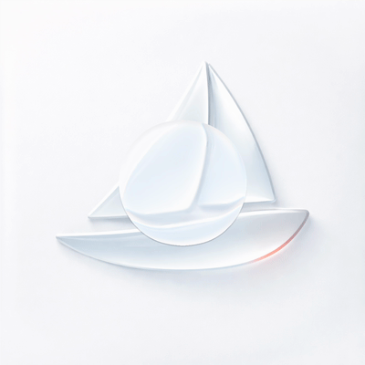
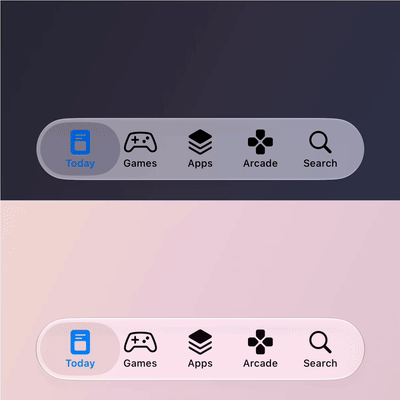
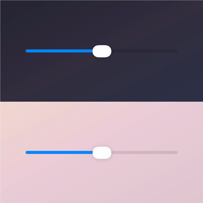
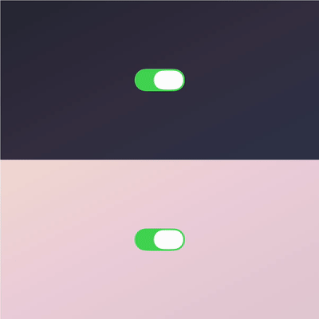
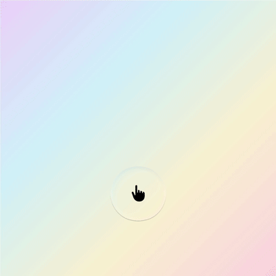
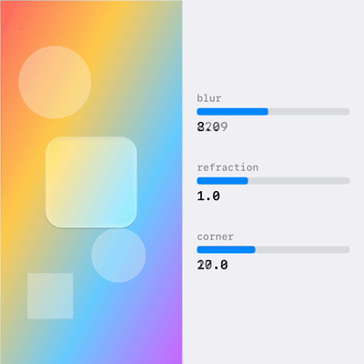
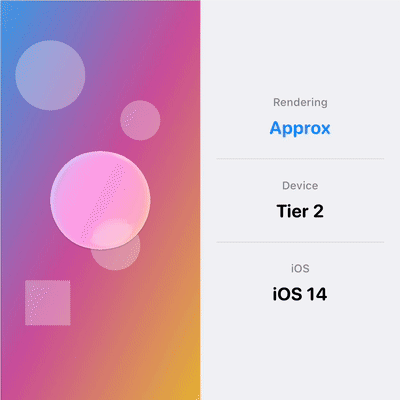

<h1 align="center">Theseus</h1>
<p align="center">
  <a href="https://drobinin.com/apps/theseus">
    
  </a>
</p>

<p align="center">
  <strong>iOS 27 Liquid Glass effects - backported to iOS 13+</strong>
</p>

<p align="center">
  
  
  
  
</p>

---

## What is Theseus?

Theseus gives you translucent UI components with blur, refraction, glare, and spring animations - the iOS 27 look, backported to iOS 13+. Same ship, rebuilt plank by plank for older waters.

Why?

Because some of us watched Apple unveil Liquid Glass at WWDC 2025 and quietly wondered if they could drop support for iOS 13. This is for everyone still supporting devices from 2015.

It got more pressing at WWDC 2026: Xcode 27 removed the old-design opt-out, so any app rebuilt with the iOS 27 SDK gets Liquid Glass whether it asked for it or not. If you support older devices, your app now looks split down the middle unless you backport. iOS 27 also gave users a system-wide clear to tinted appearance slider; Theseus replicates it on every OS version it supports (see [Tint](#tint--the-ios-27-appearance-spectrum)).

<table>
<tr>
<td width="25%" align="center">

<br><strong>TabBar</strong>
</td>
<td width="25%" align="center">

<br><strong>Slider</strong>
</td>
<td width="25%" align="center">

<br><strong>Switch</strong>
</td>
<td width="25%" align="center">

<br><strong>Glass View</strong>
</td>
</tr>
</table>

**What you get**

- The iOS 27 Liquid Glass look, running on devices from 2019
- Metal GPU rendering (with a sensible fallback for ancient hardware)
- Three drop-in components (TabBar, Slider, Switch) built on the core GlassView
- Per-view glass tint mirroring the native `Glass.tint(_:)` API
- A global clear to tinted spectrum replicating the iOS 27 user setting, with optional UserDefaults persistence
- Accessibility support out of the box
- Automatic device adaptation - it won't melt an iPhone 8
- Spring-based morphing animations

---

## Table of Contents

- [Installation](#installation)
- [Components](#components)
- [Configuration](#configuration)
- [Tint & the iOS 27 appearance spectrum](#tint--the-ios-27-appearance-spectrum)
- [Advanced](#advanced)

---

## Installation

Add to your `Package.swift`:

```swift
dependencies: [
    .package(url: "https://github.com/valzevul/Theseus.git", from: "1.0.0")
]
```

Or in Xcode: **File > Add Package Dependencies...** then paste the repository URL.

| Requirement | Version |
|-------------|---------|
| iOS | 13.0+ |
| Swift | 5.9+ |
| Metal | Optional (fallback available) |

Why iOS 13 and not lower: Metal is marked iOS 13+ in the **simulator** SDK (the simulator only gained Metal with Xcode 11), so any lower deployment target fails to compile for the simulator even though devices back to iOS 12 could run the code. A device-only iOS 12 build is possible in principle, but nobody can develop against it, so 13 is the floor.

### Quick Start

<table>
<tr>
<td width="50%">

```swift
import Theseus

let glassView = TheseusView()
glassView.shape.cornerRadius = 20
glassView.sourceView = backgroundView
view.addSubview(glassView)
```

</td>
<td width="50%" align="center">



</td>
</tr>
</table>

<details>
<summary><strong>SwiftUI</strong></summary>

Theseus is a UIKit-based library. For SwiftUI, use `UIViewRepresentable` wrappers with the Coordinator pattern for proper two-way binding.

**Complete, working wrappers are provided in:**
`TheseusDemoSwiftUI/TheseusDemoSwiftUI/Helpers/TheseusViewRepresentable.swift`

Includes:
- `TheseusViewRepresentable` - Core glass lens
- `TheseusTabBarRepresentable` - Tab bar with selection binding
- `TheseusSwitchRepresentable` - Toggle with `@Binding isOn`
- `TheseusSliderRepresentable` - Slider with `@Binding value`

| Requirement | Version |
|-------------|---------|
| Library | iOS 13+ |
| SwiftUI demo | iOS 15+ |

</details>

---

## Components

Three controls, powered by `TheseusView`.

### TheseusTabBar

The glass capsule floats over your selected tab.

<table>
<tr>
<td width="50%">

```swift
let tabBar = TheseusTabBar()
tabBar.items = [
    TheseusTabBarItem(
        icon: UIImage(systemName: "house"),
        selectedIcon: UIImage(systemName: "house.fill"),
        title: "Home"
    ),
    TheseusTabBarItem(
        icon: UIImage(systemName: "magnifyingglass"),
        title: "Search"
    ),
    // ...
]
tabBar.selectedIndex = 0
tabBar.onItemSelected = { index in
    print("Selected tab: \(index)")
}
```

</td>
<td width="50%" align="center">


</td>
</tr>
</table>

---

### TheseusSlider

The knob lifts into a clear glass capsule while you press or drag it, or snaps to positions if you need a stepper.

<table>
<tr>
<td width="50%">

```swift
let slider = TheseusSlider()
slider.minimumValue = 0
slider.maximumValue = 100
slider.setValue(50)

// For discrete positions (like a stepper)
slider.positionsCount = 5
slider.markPositions = true
```

</td>
<td width="50%" align="center">


</td>
</tr>
</table>

---

### TheseusSwitch

A toggle whose knob lifts into glass as you press, flick or drag it.

<table>
<tr>
<td width="50%" align="center">


</td>
<td width="50%">

```swift
let toggle = TheseusSwitch()
toggle.isOn = true
toggle.onTintColor = .systemGreen
toggle.offTintColor = .systemGray4
toggle.onValueChanged = { isOn in
    print("Switch: \(isOn ? "ON" : "OFF")")
}
```

</td>
</tr>
</table>

---

### TheseusView

The core building block. A fully customisable glass lens - use it to build your own components or as a standalone translucent overlay.

<table>
<tr>
<td width="50%">

```swift
let glassView = TheseusView()

// Shape
glassView.shape.cornerRadius = 24
glassView.shape.padding = CGPoint(x: 10, y: 10)

// Glass effect
glassView.blur.radius = 20
glassView.refraction.intensity = 1.2
glassView.refraction.dispersion = 3.0

// Appearance
glassView.opacity = 0.85
glassView.theme.tintColor = .systemBlue
    .withAlphaComponent(0.1)

// Connect to background
glassView.sourceView = backgroundImageView
```

</td>
<td width="50%" align="center">


</td>
</tr>
</table>

`TheseusView` supports:
- **Blur** - Gaussian blur with configurable radius
- **Refraction** - Edge distortion with chromatic dispersion
- **Edge effects** - Fresnel rim glow and specular highlights
- **Morphing** - Spring-based shape animations

---

## Configuration

### Basic

```swift
var config = TheseusConfiguration()
config.blur.radius = 20
config.shape.cornerRadius = 16
config.opacity = 0.9
config.theme.tintColor = UIColor.systemBlue.withAlphaComponent(0.1)

let glassView = TheseusView(configuration: config)
```

<details>
<summary><strong>Advanced Configuration</strong></summary>

```swift
// Refraction (glass distortion)
config.refraction.edgeWidth = 22.0      // bevel band, points
config.refraction.intensity = 1.45      // refractive index
config.refraction.dispersion = 4.0      // chromatic split at the rim
config.refraction.magnification = 1.2   // interior loupe (1 = none)

// Edge effects (rim glow / specular)
config.edgeEffects.rimGlow = 1.0
config.edgeEffects.glareIntensity = 1.0
config.edgeEffects.glareFocus = 0.75
config.edgeEffects.edgeIridescence = 0.3

// Material body (custom configurations; `.regular` and `.clear` draw
// native's own face and frost, which follow the system tint amount)
config.theme.neutralBodyScale = 1.0     // body strength (1 = native regular glass)
config.theme.backdropSaturation = 1.0   // multiplies the chroma scale native glass applies
config.theme.backdropGain = 1.0         // gain before the lift (clear glass runs 0.95)
config.theme.luminanceLift = 0.0        // additive lift, fraction of white (clear glass runs 0.12)

// Morphing animation
config.morph.tension = 0.18
config.morph.friction = 0.88
```

See `TheseusConfiguration.swift` for all available options.

</details>

---

## Tint & the iOS 27 appearance spectrum

### Per-view tint

Theseus mirrors the native `Glass` API, so moving between Theseus and `glassEffect` is mostly a rename:

```swift
// Native, iOS 26+
someView.glassEffect(.regular.tint(.blue))

// Theseus, iOS 13+
glassView.configuration = .regular.tint(.systemBlue)

// Apple folds intensity into the color's opacity; Theseus takes it
// either way, or as an explicit parameter:
glassView.configuration = .regular.tint(.systemBlue, intensity: 0.5)

// Clear material preset (use over media-rich content only)
glassView.configuration = .clear

// The tab bar's drag-lens preset (the switch and slider keep their own);
// the bar's live lens is shaped by `TheseusTabBar.lensMaterial`
glassView.configuration = .lens
```

| Native (iOS 26+) | Theseus (iOS 13+) |
|---|---|
| `.glassEffect()` | `TheseusConfiguration.regular` |
| `.glassEffect(.clear)` | `TheseusConfiguration.clear` |
| `.glassEffect(.regular.tint(.blue))` | `.regular.tint(.systemBlue)` |
| `.glassEffect(.regular.tint(.blue.opacity(0.5)))` | `.regular.tint(.systemBlue, intensity: 0.5)` |
| `.glassEffect(.regular.interactive())` | `TheseusGestureDeformer(targetView:)` |
| `GlassEffectContainer(spacing:)` | `shape.mergedShapes` + `shape.mergeSmoothing` |
| iOS 27 Tint Amount, iOS 26 Clear or Tinted | `TheseusSettings.shared.tintSpectrum` (follows the system by default) |

Components pass tint through: `TheseusTabBar` exposes `glassTint` and `glassTintIntensity`.

Highlights on tinted glass keep their hue: rim and specular highlights are recolored in OKLab space so a blue pane glints blue instead of washing out to gray. `theme.highlightTintPreservation` controls how much (0 = classic white highlights, 1 = fully hued). The tint application weights (`theme.surfaceTintWeight`, `theme.edgeTintWeight`) are also live-tunable rather than baked into the shader.

When a sheet dims your UI, the glass tint dims with it - Theseus follows UIKit's `tintAdjustmentMode` automatically on both backends, the same way native tinted controls gray out.

Follow Apple's guidance here: tint primary actions, keep brand color in the content layer, and let the glass pick it up through refraction. When everything is tinted, nothing stands out.

### Shape merging

The Theseus analog of `GlassEffectContainer`: merge nearby rounded rectangles into one continuous glass surface that melts together instead of overlapping.

```swift
glassView.shape.mergedShapes = [
    TheseusMergedShape(frame: CGRect(x: 90, y: 0, width: 60, height: 44), cornerRadius: 22)
]
glassView.shape.mergeSmoothing = 14   // blend distance in points
```

Up to 8 shapes merge with the primary shape via a smooth-union signed distance field, with refraction, rim, and specular effects following the combined outline. Metal backend only; the fallback view renders the primary shape.

### The global clear to tinted spectrum

iOS 27 added a user-facing slider that re-tints Liquid Glass across adopted apps without a recompile, and iOS 26 offers a Clear or Tinted choice. Theseus follows both by default: `followsSystemTint` (on by default) reads the setting at launch and whenever it changes, and `glassStyle` (`automatic`, `iOS26`, `iOS27`) picks which system's material the value drives. On older systems, or with following turned off, set the spectrum yourself:

```swift
// 0.0 = clear, 0.5 = system default, 1.0 = tinted (near-opaque body)
TheseusSettings.shared.tintSpectrum = 0.3
```

The control mirrors iOS 27's Settings > Appearance > Liquid Glass > "Tint Amount" slider, including its 0.5 default and its three detents (More Clear about  0.06, Default 0.5, More Tinted about  0.94). Under `glassStyle` `iOS26` the same value reads as iOS 26's Clear (0) or Tinted (1), and `systemTintSpectrum` returns the system's own value, or nil where the system has none. Setting `tintSpectrum` yourself, or enabling its persistence, turns following off.

Every Theseus view rescales its tint live, on both the Metal and fallback backends. The material model follows the iOS 27.0 release, measured over flat colour sweeps next to real `UIGlassEffect` views and the native tab bar: regular glass maps the backdrop's luminance toward white at 0.53 in light mode and through a saturating tone curve in dark mode, keeping the chroma about that luminance at a fixed scale; clear glass is a 0.95 gain plus a fixed lift in both appearances; the tab bar is the regular material; and a brand tint composites over that processed body. The slider position scales the body between the clear and the tinted extremes.

To hand the control to your users the way iOS 27 does, opt into UserDefaults persistence and bind any slider to the same key - your own settings screen, or a Settings-bundle slider:

```swift
// Once at launch:
TheseusSettings.shared.enableTintSpectrumPersistence()
// Stored under "TheseusTintSpectrum" in .standard by default;
// pass a suite or key if you need them:
TheseusSettings.shared.enableTintSpectrumPersistence(
    in: UserDefaults(suiteName: "group.example")!,
    key: "glassTint"
)
```

External changes to the key are picked up automatically. If you'd rather not have the library touch UserDefaults at all, skip the opt-in and set `tintSpectrum` yourself from whatever storage you prefer.

---

## Advanced

### Device Adaptation

Theseus automatically detects device capabilities and adjusts rendering:

| Tier | RAM / Cores | Example Devices | Rendering |
|------|-------------|-----------------|-----------|
| **Tier 3** | >=6GB, >=6 cores | iPhone 12 Pro, 13 Pro, 14 and later | Full Metal + true refraction |
| **Tier 2** | >=4GB, >=6 cores | iPhone XS, 11, 12, 13 | Metal, selective refraction |
| **Tier 1** | >=3GB | iPhone X, XR, 8 Plus, SE (2nd gen) | Metal, cheap approximation |
| **Tier 0** | <3GB | iPhone 8 and older | `UIVisualEffectView` fallback |

<table>
<tr>
<td width="50%" align="center">



</td>
<td width="50%">

<details>
<summary><strong>Override for Testing</strong></summary>

```swift
let settings = TheseusSettings.shared
settings.tierOverride = .tier0
settings.refractionPolicyOverride = .cheapApprox
settings.resetToDefaults()
```

</details>

</td>
</tr>
</table>

### Accessibility

The controls are VoiceOver elements out of the box: `TheseusSwitch` reads "On"/"Off" and toggles on double-tap, `TheseusSlider` is adjustable (swipe up or down moves it by 10% or by one position), and `TheseusTabBar` carries the tab bar trait with its items exposed as buttons that report the selected state. Set `accessibilityLabel` on any of them and Theseus leaves it alone.

System settings are honoured automatically:

| Setting | Behaviour |
|---------|----------|
| Reduce Transparency | Solid backgrounds instead of blur |
| Reduce Motion | Springs, fly-overs and lens morphs become instant moves with short cross-fades; the glass itself stays |
| Low Power Mode | Downgrades effects, reduces frame rate |

### Performance

Pause rendering when views are hidden to save GPU cycles:

```swift
glassView.pauseRendering()
glassView.resumeRendering()
```

### Demo Apps

| Demo | Path | Description |
|------|------|-------------|
| **UIKit** | `TheseusDemo/` | All components with settings panel |
| **SwiftUI** | `TheseusDemoSwiftUI/` | Complete wrappers (iOS 15+), the **iOS 27 Glass** screen (per-view tint, the clear to tinted spectrum, draggable shape merging, sheet dimming), and the **Lens Lab**: the native tab bar over the Theseus one with every drag-lens knob on a slider and a grid of static lenses that sweeps one knob |

The SwiftUI demo doubles as the calibration rig. Launch it with `-preview <scene>`
to render a capture scene full-screen (`native27` puts native `UIGlassEffect` pills
next to the Theseus presets), or `-demo <name>` to deep-route into a screen. The tab
bar demo and the Lens Lab take `-rigPattern hstripes|vstripes|gradient|flat:RRGGBB`
with `-rigStripe <pt>` and `-rigPhase <pt>`, the rig takes `-rigBackdrop
light|dark|hex:RRGGBB`, and the Lens Lab reads `-labKnob <knob> -labValues 2,3,4` for
its grid. Lens knobs are UserDefaults keys under `lens.`, so
`xcrun simctl spawn <udid> defaults write <bundle> lens.depth -float 5` retunes the
running app.

---

## License

[Apache License 2.0](LICENSE)

If you ship Theseus, I'd love a mention in About > Credits.
